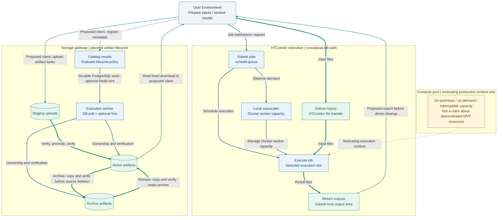
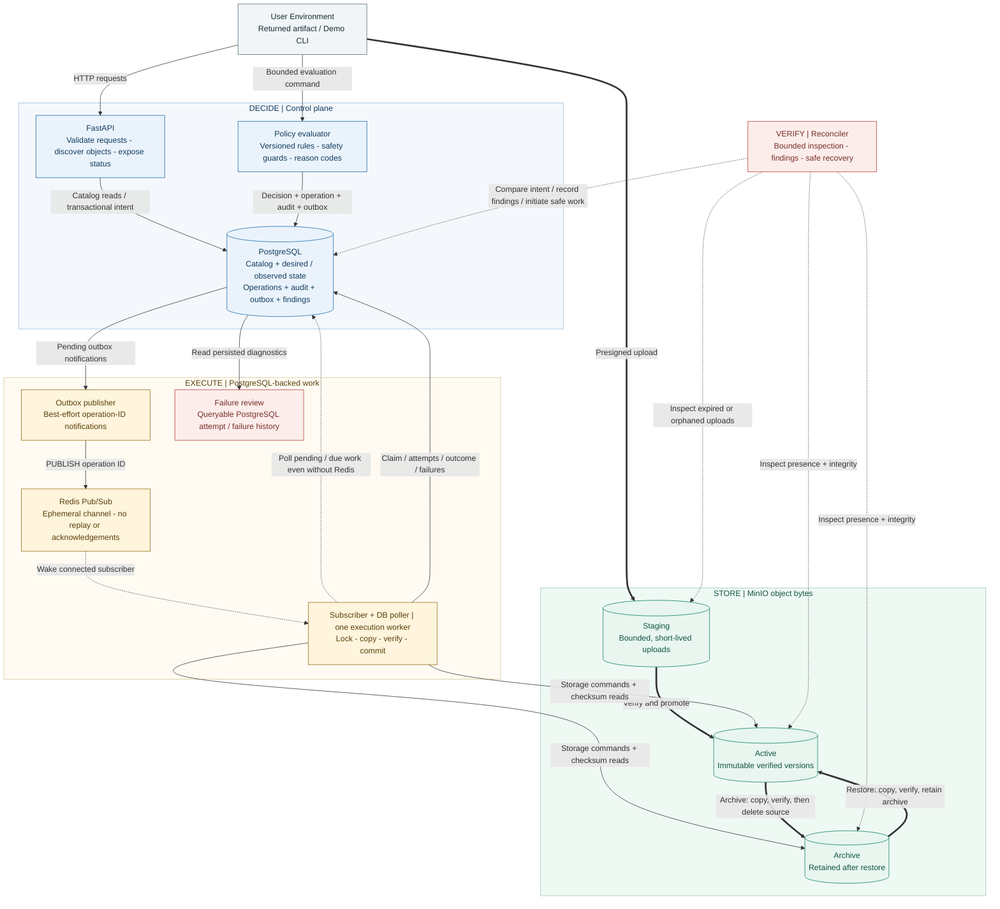

# Smart Data Control Plane

## The Bigger Picture: Compute Ends. The Data Lifecycle Continues.

A scientific computation does not end when a process exits. Inputs must reach the execution environment, results must return to the engineer, and the resulting data must remain discoverable and manageable after the compute resources are no longer needed.

This repository explores that final responsibility within a broader scientific-computing portfolio:

- **[HTCondor Distributed Computing MVP](https://github.com/Phat-pham99/HTCondor_concept_MVP)** explores distributed job execution.
- **Data-Intensive Storage Gateway** explores metadata-driven lifecycle control for the artifacts computation leaves behind.

The motivation comes from professional experience with scientific workloads spanning user environments and heterogeneous compute resources. These projects examine connected concerns: coordinating execution, returning outputs, and managing their subsequent lifecycle.

**The connection is application context, not merely file transfer.** An object's age alone does not explain its continuing usefulness. This gateway investigates how business metadata can inform archival decisions while keeping intended and observed storage states aligned.

The central question is whether finer-grained lifecycle control justifies the consistency, recovery, and operating costs of a separate metadata plane.

These repositories are complementary public demonstrations, not an already integrated platform or a reproduction of an employer's production system.

## Workflow

### Conceptual workflow animation: one job and its artifacts


**Conceptual workflow animation, not a live demo.** The 80-second loop follows one synthetic 2 MiB artifact at version 1. Blue paths carry control/metadata; green paths carry bytes; dashed paths mark proposed handoffs. One path is animated at a time. Scene labels distinguish HTCondor mechanisms, proposed handoffs, and gateway design, while the state strip keeps desired and observed placement separate.

[Open GIF](docs/assets/portfolio-workflow.gif) | [Static poster](docs/assets/portfolio-workflow.png) | [Text alternative, source evidence, and regeneration](docs/portfolio-workflow.md)

### Gateway zoom-in: the same returned artifact (conceptual)
**Conceptual workflow animation: gateway zoom-in.** Continue the same completed job 017 and synthetic 2 MiB artifact v1 from the big picture. A User Environment preserves returned results before the HTCondor demo's cleanup; that export and gateway handoff remain proposed, not implemented integration. The animation then focuses on ingestion, policy, durable work, archive, restore, and later reconciliation design.


The 80-second loop shares the portfolio animation's typography, colors and artifact identity. It highlights one handoff at a time: blue for control/metadata and green for bytes. The compute job stays complete while artifact lifecycle, desired placement and observed placement change independently. Archive verification precedes source deletion; restore retains the archive. Missing serving bytes produce uncertainty, not invented success. Reconciliation and repair are planned later work, not a demonstrated running service.

[Open GIF](docs/assets/lifecycle-workflow.gif) | [Static poster](docs/assets/lifecycle-workflow.png) | [Text alternative and regeneration](docs/portfolio-workflow.md#gateway-zoom-in-text-alternative)

For the static gateway detail, expand the target architecture section above and see the [planned reliability guarantees](#planned-reliability-guarantees-and-limits) and [failure evidence requirements](PLAN.md#7-reconciliation-and-failure-evidence).

## Shared Architectural Context



> **This diagram illustrates the shared architectural context of two independent public projects. It does not claim demonstrated end-to-end integration or reproduce an employer's production architecture.**

Thin blue arrows represent control messages and metadata; thick green arrows represent object-byte movement. Dashed blue/green paths identify proposed user/export adapters, not an existing cross-project integration. The dotted amber arrow indicates motivating compute context, not a deployed connection or demonstrated compute capacity.

The conceptual journey is **prepare inputs -> submit -> execute -> return results -> catalog -> archive -> restore**. This static diagram defines the portfolio overview. The [optional animated walkthrough](#workflow-walkthrough) follows one synthetic job and artifact through the same components, highlighting one handoff at a time. See the [source review and full text alternative](docs/portfolio-workflow.md) for what is code-based, proposed, and planned.

The HTCondor demo returns small JSON outputs to its submit host and removes its output volume during cleanup. Exporting results before that cleanup and handing them to the gateway are **proposed**, not implemented adapters. The animation uses a synthetic 2 MiB artifact and an explicit 180-day time jump so it does not imply that the demo's tiny JSON output satisfies the planned archive policy.

## Gateway Scope

A production-inspired reference project for application-aware object lifecycle governance. The target system uses PostgreSQL to store searchable business metadata and durable intent, executes archive and restore operations against S3-compatible storage, and reconciles catalog state with actual object bytes.

**The control plane decides. Object storage executes. The reconciler verifies.**

**Storage direction:** The MVP is designed to use MinIO for local development, integration tests, and demonstrations. A future production-ready version should use **Amazon S3 for globally accessed, terabyte-scale object data**.

**Current status: foundation only.** The repository contains infrastructure, models, migrations, a Celery bootstrap, and foundation tests. Upload, policy evaluation, archive/restore, reconciliation, and benchmarks are planned, not demonstrated capabilities. This is not a production-ready service.

The broader scope and exit criteria are in [PLAN.md](PLAN.md). The Redis Pub/Sub design below supersedes that document's older broker-specific messaging descriptions; the plan and runtime implementation have not yet been migrated to this revision.

[Setup](#run-the-existing-foundation) | [API status](#api-status) | [Checks](#development-and-checks) | [Evidence and limitations](#evidence-and-limitations)

## Problem and Evaluation

Native storage lifecycle rules are useful for storage-level conditions. Application-aware decisions may also require workflow completion, application access history, legal holds, and remaining retention. A separate metadata catalog enables those decisions but introduces synchronization and operational costs.

**Engineering question:** Under what workload and failure conditions does an application-aware metadata control plane justify its additional consistency and operational overhead?

The core evaluation will test:

- Whether selective indexed discovery justifies catalog maintenance, using equivalent-result baselines and measured write/index overhead.
- Whether durable intent, idempotent execution, and reconciliation recover from specified interruptions without deleting the last verified copy.

Negative results and limitations belong in the report. Cost modeling is a deferred extension, not evidence of measured financial savings.

## Current Implementation and Target

| Area | Existing foundation | Core-release target |
| --- | --- | --- |
| API | FastAPI service metadata and health endpoints | Verified upload/download, metadata discovery, lifecycle requests, operation status |
| Persistence | PostgreSQL models and initial Alembic migration | Desired/observed state, immutable versions, durable operations, outbox, audit and findings |
| Messaging | Celery with Redis; health task | Redis Pub/Sub wake-ups, independent PostgreSQL polling, idempotent execution, bounded database-scheduled retries |
| Storage | S3 configuration fields; no MinIO Compose service | MinIO staging namespace and private active/archive locations |
| Policies | Model foundation | One seeded, deterministic, versioned policy with acceptance/rejection reasons |
| Recovery | No lifecycle recovery workflow yet | Bounded reconciliation and documented failure-injection results |
| Evidence | Configuration, enum/state-transition, and health test files | Real-service integration tests, recovery matrix, reproducible discovery benchmark |

The target retains Redis and adds MinIO. Redis Pub/Sub carries ephemeral operation-ID notifications, while PostgreSQL stores durable work, attempts, retry deadlines, and failures. A subscriber and an independent bounded database poller feed one execution worker. This is a planned execution adapter, not Celery's existing Redis queue transport; the current Celery bootstrap does not implement it.

### Storage deployment roadmap

- **MVP:** MinIO provides a reproducible local S3-compatible environment with staging, active, and archive locations. The architecture chart and GIF illustrate this MVP layout.
- **Production target:** Amazon S3 provides the managed object-storage backend for globally distributed users and terabyte-scale datasets. S3 buckets are regional; region selection, data residency, cross-region replication, disaster recovery, and global access latency require explicit design. Replication is not automatic, and multi-region deployment remains outside the MVP.
- **Readiness gate:** Adopting S3 alone does not make the application production-ready. Require authentication and object-level authorization, least-privilege IAM, encryption, real-S3 integration and recovery tests, multipart transfer validation, operational monitoring, and measured control-plane throughput, recovery behavior, and storage/request/data-transfer costs. See the [production storage roadmap](PLAN.md#production-storage-roadmap-after-the-core-release).

<details>
<summary>Gateway target architecture and reliability (planned)</summary>

## Target Architecture



**Planned architecture, not the current Compose stack.** Solid arrows show control and metadata, thick arrows show object-byte movement, and dotted arrows show notification, polling, and reconciliation paths. The boxes describe logical responsibilities in one codebase, not a separate microservice for every component.

The database transaction ends before publication or storage I/O; there is no cross-system atomic transaction. A successful Redis `PUBLISH` or subscriber count does not prove that a worker received or processed a notification. The outbox records notification attempts, not acknowledged job delivery. Workers poll eligible database operations at startup and at a bounded interval regardless of notification delivery, including during Redis outages.

Storage-to-storage arrows summarize service-controlled transfers: destination bytes must be verified before success, and an archive source is deleted only after verification. Findings and failures stay durable in PostgreSQL; there is no broker-native dead-letter queue. Keep domain rules independent of infrastructure adapters.

### Planned reliability guarantees and limits

- Persist state changes, operation intent, audit events, and outbox notifications in one PostgreSQL transaction. Redis Pub/Sub is at-most-once and has no persistence, acknowledgement, replay, or automatic redelivery.
- Use notifications only to reduce pickup latency. Independently poll pending operations and due retries in bounded indexed batches, including on startup/reconnect. Lost notifications must not strand committed work, and a disconnected Redis subscriber must not block the database polling loop.
- Claim work in PostgreSQL before execution; notification and polling paths use the same per-object ownership and idempotency checks. Repeated publication or polling can rediscover the same operation; completed work is skipped without further storage mutations.
- Bind each operation to an immutable object version and checksum. Reject conflicting reuse of an idempotency key.
- Serialize mutations per object using database constraints and session advisory locks. Begin with one execution worker at concurrency 1; live takeover and distributed fencing are deferred.
- Verify actual destination size and SHA-256 before deleting an archive source or declaring success. Verification reads stored bytes; it is not a zero-payload-through-worker design.
- Restore returns the object to `ACTIVE` and intentionally retains the archive copy. Reconciliation must distinguish that replica from unexpected duplication.
- Persist attempts, bounded retry deadlines, and exhausted failures in PostgreSQL. Database polling, not Pub/Sub, schedules retries. Validate notification payloads, log/count malformed notifications without executing them, and use persisted failure history for admin review and explicit retry rather than assuming a dead-letter queue exists.
- Test subscriber disconnect/reconnect, publication before subscription, Redis restart/outage, duplicate publication, and a successful `PUBLISH` whose notification never reaches execution. Verify recovery from the database and measure the polling latency/load trade-off; fewer technologies does not establish lower cost by itself.
- Record discrepancies and repair only evidence-backed, authorized cases. Destructive ambiguity requires manual review.

Worker timeout alone does not establish exclusive ownership. The core assumes controlled single-worker restart, settled in-flight requests, and bounded storage timeouts. Database polling must not blindly reclaim running work after a timeout; uncertain ownership requires controlled recovery. The storage and ownership rules in the [reliability contract](PLAN.md#4-reliability-contract) still apply, but its older broker-confirmation and dead-letter provisions do not describe this Pub/Sub revision.

</details>

## Run the Existing Foundation

Prerequisites: Docker with Docker Compose. Local development additionally requires Python 3.12+; `uv` is optional.

```bash
cp .env.example .env
docker compose up --build
```

The current Compose configuration starts PostgreSQL 16, Redis 7, FastAPI, and a Celery worker with the health task registered. It does **not** provide MinIO, the planned Pub/Sub subscriber/database poller, or a working lifecycle demonstration. The API container applies migrations at startup.

```bash
curl http://localhost:8000/
curl http://localhost:8000/health
curl http://localhost:8000/health/ready
```

OpenAPI documentation: <http://localhost:8000/docs>. Readiness currently checks PostgreSQL and Redis; it is not evidence of storage or lifecycle readiness.

Treat this foundation as a trusted local development environment only. The current Compose file publishes service ports without loopback-only binding; restrict network access before starting it. Loopback binding and least-privilege storage permissions are planned baseline work, not existing protections.

### Current configuration

See [.env.example](.env.example) and [app/config.py](app/config.py). Keep real secrets outside Git.

| Variable | Current purpose |
| --- | --- |
| `DATABASE_URL` | PostgreSQL connection URL |
| `REDIS_URL` | Default Celery broker/backend and current readiness dependency |
| `CELERY_BROKER_URL`, `CELERY_RESULT_BACKEND` | Optional Celery URL overrides; readiness still checks Redis |
| `S3_REGION`, `S3_BUCKET`, `S3_ENDPOINT_URL` | Storage configuration fields; workflows are not implemented |
| `AWS_ACCESS_KEY_ID`, `AWS_SECRET_ACCESS_KEY` | Optional storage credentials; use local synthetic resources only |
| `ADMIN_API_KEY` | Configuration field only; no admin endpoint enforcement is implemented |

Do not interpret configuration fields as evidence that their associated features exist.

## API Status

Currently implemented:

```text
GET /                 Service metadata
GET /health           Process liveness
GET /health/ready     PostgreSQL and Redis readiness
```

The planned core API adds upload initiation/completion, object lookup and cursor-paginated discovery, download, application-access recording, archive/restore requests, job status, an admin retry endpoint, and metrics. These routes are specified in [PLAN.md](PLAN.md#6-deterministic-policy-and-minimal-interfaces); they are not available yet.

Policy evaluation, outbox notification publication, reconciliation, and finding inspection will start as bounded CLI commands rather than a large admin API. The execution adapter will continuously subscribe and independently poll eligible database operations and due retries.

## Delivery Milestones

All four consolidated milestones remain planned. The existing foundation is a starting point, not a completed Milestone 1.

| Milestone | Required exit evidence | Status |
| --- | --- | --- |
| 1. Verified catalog round trip | Existing Redis/PostgreSQL plus MinIO; upload, checksum verification, query, download, duplicate handling, and restart persistence | Planned |
| 2. One complete lifecycle | Explainable policy -> archive -> restore; Pub/Sub wake-ups with database polling, missed-notification recovery, safe duplicates, concurrency guards, persisted retry/failure evidence | Planned |
| 3. Recovery and demonstration | Bounded reconciliation, findings, minimal metrics, and documented outcomes for every failure-matrix case | Planned |
| 4. Evaluation and public evidence | Clean-checkout demonstration, fair discovery benchmark, maintenance overhead, and reproducible results report | Planned |

At each milestone, update implemented/tested/planned status, run the full available suite and required CI gates, and record commands, environment, outcomes, and limitations. Blocked integration tests do not satisfy exit criteria.

**Core completion:** A new user can reproduce upload -> evaluate -> archive -> restore -> verify, recover from specified injected failures, and run a modest-scale benchmark.

## Development and Checks

```bash
uv venv --python 3.12
uv pip install -e ".[dev]"
source .venv/bin/activate

ruff check .
ruff format --check .
pytest

# Requires the configured PostgreSQL instance.
alembic upgrade head
```

Current tests cover configuration, enums/state transitions, and health behavior. They do not establish end-to-end lifecycle correctness.

The existing [CI workflow](.github/workflows/ci.yml) configures lint, format checks, migration upgrade, and tests with coverage on pull requests and pushes to `main` or `feature/**`. This describes configured checks, not a claim that the latest run passed. Real-service lifecycle integration tests, failure injection, and dependency/container scanning remain planned gates.

## Evidence and Limitations

The evaluation will compare indexed queries with a catalog baseline without the candidate index and with equivalent namespace enumeration at the same physical population. Enumeration must obtain equivalent business metadata, not merely list keys. Report request counts, selectivity, cache conditions, repeated latency measurements, and query plans alongside ingestion, verification, and reconciliation overhead.

Begin with 100K logical catalog rows and a separately declared practical population of real small objects. Never present logical row counts as physically stored or processed capacity. No performance or recovery results are claimed here yet.

Two MinIO buckets demonstrate lifecycle orchestration, not Glacier retrieval behavior or actual archival pricing. Optional economic scenarios must include retained copies, requests, transitions, retrieval, and minimum-duration assumptions, and must be labeled as modeled projections.

Deferred work includes Grafana, rich policy administration, bulk folder operations, cost estimation, larger logical experiments, multi-worker scaling, the production Amazon S3 deployment, enterprise identity, and separately justified recommendation-only ML. Kubernetes, a custom frontend, and multi-region replication are outside the core scope. Terabyte-scale storage and global access are production design targets, not measured capabilities of this MVP.

Use synthetic/public material only. Owner metadata is not authorization, and the service must not be exposed to untrusted users without authentication and object-level access controls. Neither production readiness nor cross-system atomicity is claimed.

## License

[MIT](LICENSE)